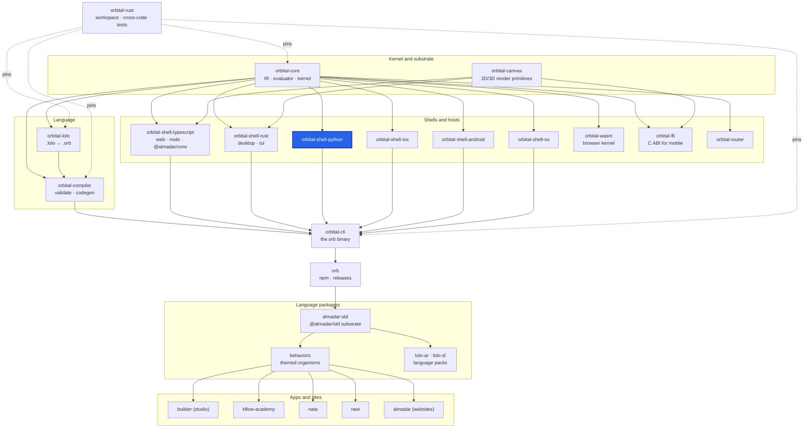

<div align="center">

# orbital-shell-python

**The Python shell: generates a Python host that serves a compiled Orbital program on the native kernel.**

[](https://github.com/almadar-io/orbital-shell-python/actions/workflows/ci.yml) [](LICENSE)

</div>

The Python shell ships a served program as a small Python project. The program runs on the native kernel through the `orbital_kernel` extension; the project holds the program, the language bundle it runs against and a short entry point.

## Where this fits



| Upstream (this repo depends on) | Downstream (depends on this repo) |
|---|---|
| [orbital-core](https://github.com/almadar-io/orbital-core): IR, evaluator and kernel (`orbital-core-base`, `orbital-core-eval`) | [orbital-cli](https://github.com/almadar-io/orbital-cli): the `orb` binary, which runs this shell as `orb-shell-python` for `orb compile --shell python` |
| [orbital-wasm](https://github.com/almadar-io/orbital-wasm) and [orbital-shell-rust](https://github.com/almadar-io/orbital-shell-rust): the kernel and host behind `bridges/native` only |  |

## Quick start

```bash
orb compile <program.orb> --shell python -o <out-dir>
cd <out-dir>
python -m venv .venv && source .venv/bin/activate
pip install -e .
python -m orbital_app
```

The generated server listens on port 3030 (`PORT` replaces it).

## How `orb compile --shell python` uses it

`orb` runs the `orb-shell-python` program, which needs a served program in the request. It scaffolds `templates/python-shell`, writes `src/orbital_app/generated/program.orb` and `language.json`, and ships the native kernel extension (`orbital_kernel.abi3.so`, `orbital_kernel.pyd` on Windows) into the project's `kernel/` directory. `src/orbital_app/main.py` loads both and calls `orbital_kernel.serve`. The kernel is the `orbital-wasm` server API compiled as a CPython abi3 module by `bridges/native` (`orbital-python`, Python 3.10+).

## Layout

| Path | Contents |
|---|---|
| `src/` | The crate: backend, kernel host, shell, `orb-shell-python` program |
| `templates/python-shell/` | Project scaffold: `pyproject.toml`, `Dockerfile`, `src/`, `kernel/` |
| `bridges/native/` | `orbital-python`: the native Python extension of the kernel |
| `core/almadar-core-py/` | Generated Python core types |

## Development

The crate reads the Almadar language data (patterns, operators, themes, vocabularies) from the installed npm packages, so install those first (this is the CI recipe):

```bash
npm install --no-save --no-package-lock @almadar/core@^10 @almadar/std@^16 @almadar/lolo-ar@^1 @almadar/lolo-sl@^1
cargo test
```

Open gaps are tracked in [Almadar_Gaps.md](Almadar_Gaps.md). Work on `main`; never create a feature branch.

## Docs

- [Orb documentation](https://orb.almadar.io/docs): the language, the `orb` CLI and how the pieces fit

## License

[Business Source License 1.1](LICENSE): free for non-commercial and evaluation use; converts to Apache-2.0 on the change date.
